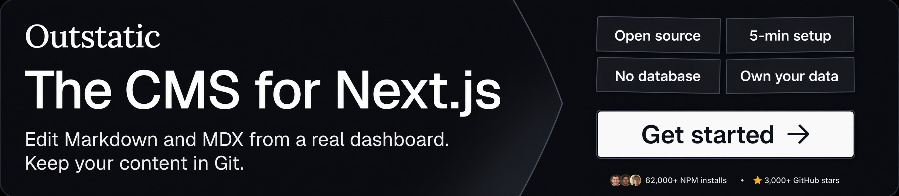

# remark-flexible-toc

**A robust Next.js newsletter `Next.js Weekly` is sponsoring me** 💖
[](https://nextjsweekly.com/)

**An outstanding Git-based CMS `Outstatic` is also sponsoring me** 💖
[](https://outstatic.com/?utm_source=github&utm_medium=readme&utm_campaign=next-mdx-remote-client)

A warm thanks 🙌 to [@ErfanEbrahimnia](https://github.com/ErfanEbrahimnia), [@avitorio](https://github.com/avitorio), [@recepkyk](https://github.com/recepkyk), and [@LSeaburg](https://github.com/LSeaburg) for the [support](https://github.com/sponsors/ipikuka) 💖

---

[![npm version][badge-npm-version]][url-npm-package]
[![npm downloads][badge-npm-download]][url-npm-package]
[![publish to npm][badge-publish-to-npm]][url-publish-github-actions]
[![code-coverage][badge-codecov]][url-codecov]
[![type-coverage][badge-type-coverage]][url-github-package]
[![typescript][badge-typescript]][url-typescript]
[![license][badge-license]][url-license]

This package is a [**unified**][unified] ([**remark**][remark]) plugin **to expose the table of contents via `Vfile.data` or via an option reference in markdown.**

**`remark-flexible-toc`** also exports `generateTocItemsFromMdast` to generate the table of contents items directly from an MDAST tree without requiring a unified processor or a VFile.

[**unified**][unified] is a project that transforms content with abstract syntax trees (ASTs) using the new parser [**micromark**][micromark]. [**remark**][remark] adds support for markdown to unified. [**mdast**][mdast] is the Markdown Abstract Syntax Tree (AST) which is a specification for representing markdown in a syntax tree.

**This plugin is a remark plugin that doesn't transform the MDAST but gets info from the MDAST.**

## When should I use this?

**`remark-flexible-toc`** is useful if you want to get the table of contents (TOC) from the markdown/MDX document. It exposes the table of contents (TOC) in two ways:
+ by adding a `toc` object into `Vfile.data`
+ by mutating a reference array if provided in the options
+ by generating `TocItem[]` directly from an MDAST tree with `generateTocItemsFromMdast`

## Installation

This package is suitable for ESM only. In Node.js (version 16+), install with npm:

```bash
npm install remark-flexible-toc
```

or

```bash
yarn add remark-flexible-toc
```

## Usage

Say we have the following file, `example.md`, which consists some headings.

```markdown
# The Main Heading

## Section

### Subheading 1

### Subheading 2
```

Say `example.js` looks as followings *(two ways):*

#### The first way of getting TOC via file.data

```javascript
import { read } from "to-vfile";
import remark from "remark";
import gfm from "remark-gfm";
import remarkRehype from "remark-rehype";
import rehypeStringify from "rehype-stringify";
import remarkFlexibleToc from "remark-flexible-toc";

main();

async function main() {
  const file = await remark()
    .use(gfm)
    .use(remarkFlexibleToc)
    .use(remarkRehype)
    .use(rehypeStringify)
    .process(await read("example.md"));

  console.log(file.data.toc);
}
```

#### The second way of getting TOC via a reference array in the options

```javascript
import { read } from "to-vfile";
import remark from "remark";
import gfm from "remark-gfm";
import remarkRehype from "remark-rehype";
import rehypeStringify from "rehype-stringify";
import remarkFlexibleToc from "remark-flexible-toc";

main();

async function main() {
  const toc = [];

  const file = await remark()
    .use(gfm)
    .use(remarkFlexibleToc, {tocRef: toc})
    .use(remarkRehype)
    .use(rehypeStringify)
    .process(await read("example.md"));

  console.log(toc);
}
```

Now, running both `node example.js` you will see that the same table of contents (TOC) is logged in the console:

```javascript
[
  {
    content: [{ type: "text", value: "Section" }],
    depth: 2,
    href: "#section",
    numbering: [1, 1],
    parent: "root",
    parentPath: [],
    value: "Section",
  },
  {
    content: [{ type: "text", value: "Subheading 1" }],
    depth: 3,
    href: "#subheading-1",
    numbering: [1, 1, 1],
    parent: "root",
    parentPath: [],
    value: "Subheading 1",
  },
  {
    content: [{ type: "text", value: "Subheading 2" }],
    depth: 3,
    href: "#subheading-2",
    numbering: [1, 1, 2],
    parent: "root",
    parentPath: [],
    value: "Subheading 2",
  },
]
```

Without **`remark-flexible-toc`**, there wouldn't be any `toc` key in the `file.data`:

#### Generating TOC items directly from MDAST

If you already have an MDAST tree, you can generate the table of contents items directly without using the remark plugin, a unified processor, or a VFile.

```js
import { generateTocItemsFromMdast } from "remark-flexible-toc";

const tocItems = generateTocItemsFromMdast(tree, {
  maxDepth: 4,
});

console.log(tocItems);
```

The function returns `TocItem[]` and does not modify the MDAST tree.

The available options are `maxDepth`, `skipLevels`, `includeParents`, `skipParents`, `exclude`, `prefix`, and `after`.

## Options

All options are **optional**.

```typescript
import type { Test } from "unist-util-is";

type HeadingParent =
  | "root"
  | "blockquote"
  | "footnoteDefinition"
  | "listItem"
  | "container"
  | "mdxJsxFlowElement";

type HeadingDepth = 1 | 2 | 3 | 4 | 5 | 6;

use(remarkFlexibleToc, {
  tocName?: string; // default: "toc"
  tocRef?: TocItem[]; // default: []
  maxDepth?: HeadingDepth; // default: 6
  skipLevels?: HeadingDepth[]; // default: [1]
  includeParents?: Test;
  skipParents?: Test;
  exclude?: string | string[];
  prefix?: string;
  after?: string;
  callback?: (toc: TocItem[]) => undefined;
} as FlexibleTocOptions);
```

`generateTocItemsFromMdast` accepts only the options related to generating the TOC items. The plugin-specific `tocName`, `tocRef`, and `callback` options are not applicable.

```ts
type GenerateTocItemsOptions = Pick<
  FlexibleTocOptions,
  | "maxDepth"
  | "skipLevels"
  | "includeParents"
  | "skipParents"
  | "exclude"
  | "prefix"
  | "after"
>;

```

#### `tocName`

It is a **string** option in which the table of contents (TOC) is placed in the `vfile.data`. 

By default it is **`toc`**, meaningly the TOC is reachable via `vfile.data.toc`.

```javascript
use(remarkFlexibleToc, {
  tocName: "headings";
});
```
Now, the TOC is accessable via `vfile.data.headings`.

#### `tocRef`

It is an **array of reference** option for getting the table of contents (TOC), which is the second way of getting the TOC from **`remark-flexible-toc`**.

The reference array should be an empty array, if not, it is emptied by the plugin.

If you use _typescript_, the array reference should be `const toc: TocItem[] = []`.

```javascript
const toc = [];

use(remarkFlexibleToc, {
  tocRef: toc; // `remark-flexible-toc` mutates the array of reference
});
```

Now, the TOC is accessable via `toc`.

#### `maxDepth`

It is a **number** option for indicating the max heading depth to include in the TOC.

By default it is `6`. Meaningly, there is no restriction by default.

```javascript
use(remarkFlexibleToc, {
  maxDepth: 4;
});
```

The `maxDepth` option is inclusive: when set to 4, level fourth headings are included, but fifth and sixth level headings will be skipped.

#### `skipLevels` 

It is an **array** option to indicate the heading levels to be skipped. 

By default it is `[1]` since the first level heading is not expected to be in the TOC.

```javascript
use(remarkFlexibleToc, {
  skipLevels: [1, 2, 4, 5, 6];
});
```

Now, the TOC consists only the third level headings.

#### `includeParents`

It uses a [`unist-util-is`][unist-util-is] compatible **`Test`** to allow headings to be children of certain nodes.

The option has no default value, meaningly there is no parent restriction by default.

```javascript
use(remarkFlexibleToc, {
  includeParents: ["root", "listItem"];
});
```

Now, only the headings whose immediate parent is the `root` or a `listItem` will be added into the TOC.

#### `skipParents`

It uses a [`unist-util-is`][unist-util-is] compatible **`Test`** to disallow headings to be children of certain nodes.

The option has no default value, meaningly there is no parent to be skipped by default.

```javascript
use(remarkFlexibleToc, {
  skipParents: ["blockquote"];
});
```

Now, the headings in the `<blockquote>` will not be added into the TOC.

If `includeParents` and `skipParents` match the same parent, `skipParents` wins. The `root` is not protected specially and can also be skipped.

#### `exclude`

It is a **string** or **string[]** option. The plugin wraps the string(s) in new RegExp('^(' + value + ')$', 'i'), so any heading matching this expression will not be present in the TOC. The RegExp checks exact (not contain) matching and case insensitive as you see.

The option has no default value.

```javascript
use(remarkFlexibleToc, {
  exclude: "The Subheading";
});
```
Now, the heading "The Subheading" will not be included in to the TOC, but forexample "The Subheading Something" will be included.

#### `prefix`

It is a **string** option to add a prefix to `href`s of the TOC items. It is useful for example when later going from markdown to HTML and sanitizing with `rehype-sanitize`.

The option has no default value.

```javascript
use(remarkFlexibleToc, {
  prefix: "text-prefix-";
});
```
Now, all TOC items' `href`s will start with that prefix like `#text-prefix-the-subheading`.

#### `after`

It is a **string** option for indicating a heading section after which the TOC items will be generated.

The plugin wraps the string in new RegExp('^(' + value + ')$', 'i'), so the first heading matching this expression is used. The matched heading and its section are not included. The collection starts with the next heading having the same or a higher level, and continues with the following headings.

The option has no default value.

```javascript
use(remarkFlexibleToc, {
  after: "(table[ -]of[ -])?contents?|toc";
});
```

This is useful when a table of contents heading already exists in the document and you want to generate the TOC items only for the headings after that section.

#### `callback`

It is a **callback function** `callback?: (toc: TocItem[]) => undefined;` which takes the TOC items as an argument and returns nothing. It is usefull for logging the TOC, forexample, or modifing the TOC. **It is allowed that the callback function is able to mutate the TOC items !**

The option has no default value.

```javascript
use(remarkFlexibleToc, {
  callback: (toc) => {
    console.log(toc);
  };
});
```

Now, each time when you compile the source, the TOC will be logged into the console for debugging purpose.

## A Table of Content (TOC) Item

```typescript
import type { PhrasingContent } from "mdast";

type TocItem = {
  value: string; // heading text
  content: PhrasingContent[]; // normalized rich heading content to be used safely inside a TOC link
  href: string; // produced uniquely by "github-slugger" using the value of the heading
  depth: HeadingDepth; // 1 | 2 | 3 | 4 | 5 | 6
  numbering: number[]; // explained below
  parent: HeadingParent; // "root"| "blockquote" | "footnoteDefinition" | "listItem" | "container" | "mdxJsxFlowElement"
  parentPath: number[]; // child-index path from the MDAST root to the heading's immediate parent
  data?: Record<string, unknown>; // Other remark plugins may store custom data in "node.data.hProperties" like "id" etc.
};
```

The `content` keeps the rich MDAST phrasing content of the heading. Links and link references are unwrapped to prevent nested links, footnote references are omitted, and position information is removed. The content is cloned, so mutating it does not mutate the heading in the MDAST tree.

The `parentPath` identifies the heading's exact structural parent in the input MDAST tree by child indexes. A heading whose immediate parent is the root has `parentPath: []`. For example, if a heading is inside the second root child and that child is its immediate parent, the path is `[1]`; if its immediate parent is the first child of that node, the path is `[1, 0]`. The path is computed from the input MDAST structure before TOC filtering, so options such as `skipLevels`, `exclude`, `maxDepth`, and `after` do not renumber or rebase it.

Regional or section-specific tables of contents can be implemented using `parentPath`.

> [!NOTE]
> If there is a remark plugin before **`remark-flexible-toc`** in the plugin chain like **`remark-heading-id`** or **`remark-custom-header-id`**, which provides custom id for headings, that custom id takes precedence for `href`.

**`remark-flexible-toc`** uses **`github-slugger`** internally for producing unique links. Then, it is possible you to use [**rehype-slug**][rehype-slug] (forIDs on headings) and [**rehype-autolink-headings**][rehype-autolink-headings] (for anchors that link-to-self) because they use the same **`github-slugger`**.

As an example for the unique heading links (notice the same heading texts).

```markdown
# The Main Heading

## Section

### Subheading

## Section
      
### Subheading
```

The `github-slugger` produces unique links with using a counter mechanism internally, and the TOC item's `href`s is going to be unique.

```javascript
[
  {
    depth: 2,
    href: "#section",
    numbering: [1, 1],
    parent: "root",
    parentPath: [],
    value: "Section",
  },
  {
    depth: 3,
    href: "#subheading",
    numbering: [1, 1, 1],
    parent: "root",
    parentPath: [],
    value: "Subheading",
  },
  {
    depth: 2,
    href: "#section-1",
    numbering: [1, 2],
    parent: "root",
    parentPath: [],
    value: "Section",
  },
  {
    depth: 3,
    href: "#subheading-1",
    numbering: [1, 2, 1],
    parent: "root",
    parentPath: [],
    value: "Subheading",
  },
]
```

## Numbering for Ordered Table of Contents (TOC)

**`remark-flexible-toc`** produces always the `numbering` for TOC items in case you show the ordered TOC.

The **numbering** of a TOC item is an array of number. The numbers in the `numbering` corresponds the **level of the headers**. With that structure, you know which header is under which header.

```js
[1, 1]
[1, 2]
[1, 2, 1]
[1, 2, 2]
[1, 3]
```

The first number of the `numbering` is related with the fist level headings.
The second number of the `numbering` is related with the second level headings.
And so on...

If yo haven't included the first level header into the TOC, you can slice the `numbering` with `1` so as to second level headings starts with `1` and so on..

```javascript
tocItem.numbering.slice(1);
```

You can join the `numbering` as you wish. It is up to you to combine the `numbering` with dot, or dash.

```javascript
tocItem.numbering.join(".");
tocItem.numbering.join("-");
```

## Syntax tree

This plugin does not modify the `mdast` (markdown abstract syntax tree), collects data from the `mdast` and adds information into the `vfile.data` if required.

`generateTocItemsFromMdast` also does not modify the provided MDAST tree.

## Types

This package is fully typed with [TypeScript][url-typescript] and also exports the `generateTocItemsFromMdast` utility function.

The plugin exports the types `FlexibleTocOptions`, `HeadingParent`, `HeadingDepth`, `TocItem` and `GenerateTocItemsOptions`.

## Compatibility

This plugin works with `unified` version 6+ and `remark` version 7+. It is compatible with `mdx` version 2+.

## Security

Use of **`remark-flexible-toc`** does not involve rehype (hast) or user content so there are no openings for cross-site scripting (XSS) attacks.

## My Plugins

I like to contribute the Unified / Remark / MDX ecosystem, so I recommend you to have a look my plugins.

### Support My Work ([become a sponsor](https://github.com/sponsors/ipikuka) 🚀)

If you find **`remark-flexible-toc`** or any of my projects is useful and helpful, please consider supporting my work. Your sponsorship means a lot to me and keeps these projects alive and updated! 💖

My sponsors are going to be featured at the very top of the page and proudly displayed on my [Sponsor Wall](https://github.com/sponsors/ipikuka).

Thank you for supporting open source! 🙌

### My Remark Plugins

- [`remark-flexible-code-titles`](https://www.npmjs.com/package/remark-flexible-code-titles)
  – Remark plugin to add titles or/and containers for the code blocks with customizable properties
- [`remark-flexible-containers`](https://www.npmjs.com/package/remark-flexible-containers)
  – Remark plugin to add custom containers with customizable properties in markdown
- [`remark-ins`](https://www.npmjs.com/package/remark-ins)
  – Remark plugin to add `ins` element in markdown
- [`remark-flexible-paragraphs`](https://www.npmjs.com/package/remark-flexible-paragraphs)
  – Remark plugin to add custom paragraphs with customizable properties in markdown
- [`remark-flexible-markers`](https://www.npmjs.com/package/remark-flexible-markers)
  – Remark plugin to add custom `mark` element with customizable properties in markdown
- [`remark-flexible-toc`](https://www.npmjs.com/package/remark-flexible-toc)
  – Remark plugin to expose the table of contents via `vfile.data` or via an option reference
- [`remark-mdx-remove-esm`](https://www.npmjs.com/package/remark-mdx-remove-esm)
  – Remark plugin to remove import and/or export statements (mdxjsEsm)
- [`remark-mdx-remove-expressions`](https://www.npmjs.com/package/remark-mdx-remove-expressions)
  – Remark plugin to remove MDX expressions within curlybraces {} in MDX content

### My Rehype Plugins

- [`rehype-pre-language`](https://www.npmjs.com/package/rehype-pre-language)
  – Rehype plugin to add language information as a property to `pre` element
- [`rehype-highlight-code-lines`](https://www.npmjs.com/package/rehype-highlight-code-lines)
  – Rehype plugin to add line numbers to code blocks and allow highlighting of desired code lines
- [`rehype-code-meta`](https://www.npmjs.com/package/rehype-code-meta)
  – Rehype plugin to copy `code.data.meta` to `code.properties.metastring`
- [`rehype-image-toolkit`](https://www.npmjs.com/package/rehype-image-toolkit)
  – Rehype plugin to enhance Markdown image syntax `` and Markdown/MDX media elements (``, `<audio>`, `<video>`) by auto-linking bracketed or parenthesized image URLs, wrapping them in `<figure>` with optional captions, unwrapping images/videos/audio from paragraph, parsing directives in title for styling and adding attributes, and dynamically converting images into `<video>` or `<audio>` elements based on file extension.

### My Recma Plugins

- [`recma-mdx-escape-missing-components`](https://www.npmjs.com/package/recma-mdx-escape-missing-components)
  – Recma plugin to set the default value `() => null` for the Components in MDX in case of missing or not provided so as not to throw an error
- [`recma-mdx-change-props`](https://www.npmjs.com/package/recma-mdx-change-props)
  – Recma plugin to change the `props` parameter into the `_props` in the `function _createMdxContent(props) {/* */}` in the compiled source in order to be able to use `{props.foo}` like expressions. It is useful for the `next-mdx-remote` or `next-mdx-remote-client` users in `nextjs` applications.
- [`recma-mdx-change-imports`](https://www.npmjs.com/package/recma-mdx-change-imports)
  – Recma plugin to convert import declarations for assets and media with relative links into variable declarations with string URLs, enabling direct asset URL resolution in compiled MDX.
- [`recma-mdx-import-media`](https://www.npmjs.com/package/recma-mdx-import-media)
  – Recma plugin to turn media relative paths into import declarations for both markdown and html syntax in MDX.
- [`recma-mdx-import-react`](https://www.npmjs.com/package/recma-mdx-import-react)
  – Recma plugin to ensure getting `React` instance from the arguments and to make the runtime props `{React, jsx, jsxs, jsxDev, Fragment}` is available in the dynamically imported components in the compiled source of MDX.
- [`recma-mdx-html-override`](https://www.npmjs.com/package/recma-mdx-html-override)
  – Recma plugin to allow selected raw HTML elements to be overridden via MDX components.
- [`recma-mdx-interpolate`](https://www.npmjs.com/package/recma-mdx-interpolate)
  – Recma plugin to enable interpolation of identifiers wrapped in curly braces within the `alt`, `src`, `href`, and `title` attributes of markdown link and image syntax in MDX.

### My Unist Utils and Unified Plugins

I also build low-level utilities and plugins for the Unified ecosystem that can be used across Remark, Rehype, Recma, and other unist-based abstract syntax trees (ASTs).

- [`unist-util-find-between`](https://www.npmjs.com/package/unist-util-find-between)
  – Unist utility to find the nodes between two nodes.
- [`unified-log-tree`](https://www.npmjs.com/package/unified-log-tree)
  – Unified plugin to log abstract syntax trees (ASTs) for debugging without mutating.

## License

[MIT License](./LICENSE) © ipikuka

[unified]: https://github.com/unifiedjs/unified
[micromark]: https://github.com/micromark/micromark
[remark]: https://github.com/remarkjs/remark
[remarkplugins]: https://github.com/remarkjs/remark/blob/main/doc/plugins.md
[mdast]: https://github.com/syntax-tree/mdast
[unist-util-is]: https://github.com/syntax-tree/unist-util-is
[rehype-slug]: https://github.com/rehypejs/rehype-slug
[rehype-autolink-headings]: https://github.com/rehypejs/rehype-autolink-headings

[badge-npm-version]: https://img.shields.io/npm/v/remark-flexible-toc
[badge-npm-download]:https://img.shields.io/npm/dt/remark-flexible-toc
[url-npm-package]: https://www.npmjs.com/package/remark-flexible-toc
[url-github-package]: https://github.com/ipikuka/remark-flexible-toc

[badge-license]: https://img.shields.io/github/license/ipikuka/remark-flexible-toc
[url-license]: https://github.com/ipikuka/remark-flexible-toc/blob/main/LICENSE

[badge-publish-to-npm]: https://github.com/ipikuka/remark-flexible-toc/actions/workflows/publish.yml/badge.svg
[url-publish-github-actions]: https://github.com/ipikuka/remark-flexible-toc/actions/workflows/publish.yml

[badge-typescript]: https://img.shields.io/npm/types/remark-flexible-toc
[url-typescript]: https://www.typescriptlang.org/

[badge-codecov]: https://codecov.io/gh/ipikuka/remark-flexible-toc/graph/badge.svg?token=QBNX6L8W2G
[url-codecov]: https://codecov.io/gh/ipikuka/remark-flexible-toc

[badge-type-coverage]: https://img.shields.io/badge/dynamic/json.svg?label=type-coverage&prefix=%E2%89%A5&suffix=%&query=$.typeCoverage.atLeast&uri=https%3A%2F%2Fraw.githubusercontent.com%2Fipikuka%2Fremark-flexible-toc%2Fmaster%2Fpackage.json
